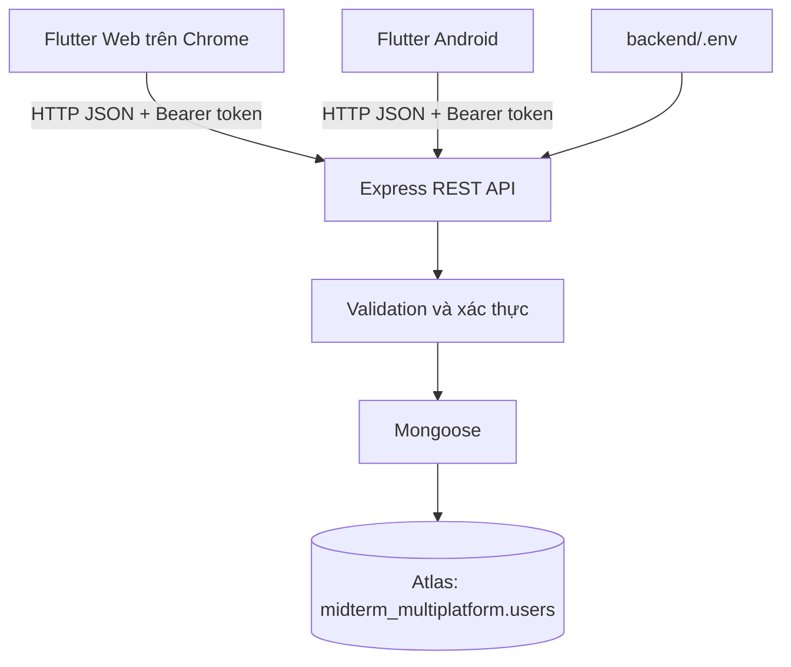
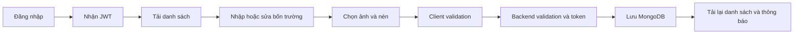
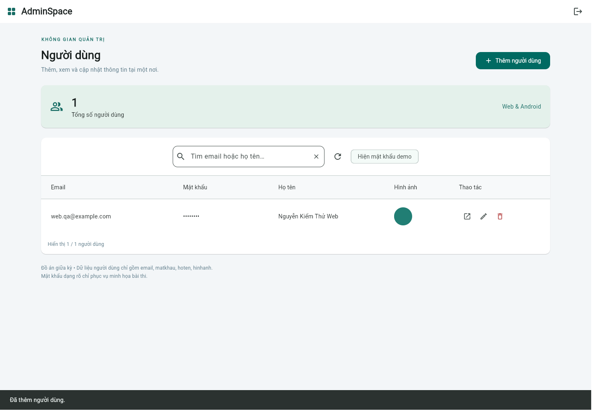
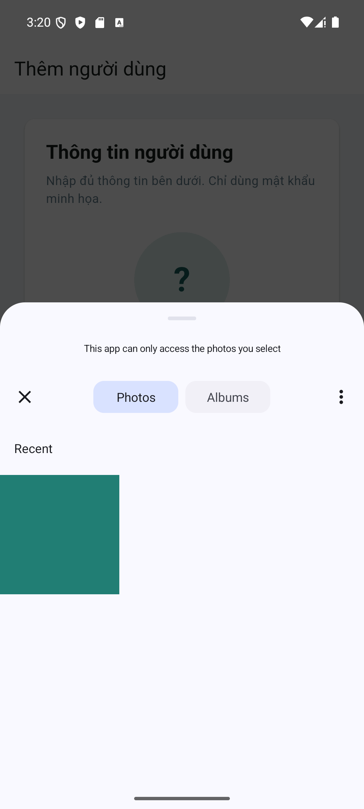
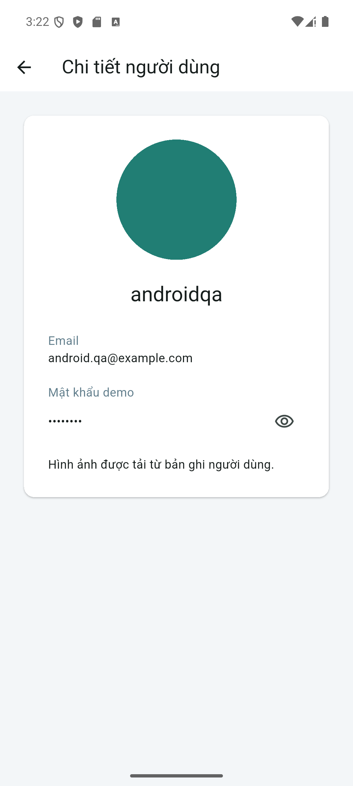

# BÁO CÁO GIỮA KỲ — LẬP TRÌNH ĐA NỀN TẢNG

**Đề tài:** Xây dựng ứng dụng quản lý người dùng cho Admin trên Flutter Web và Android, sử dụng MongoDB Atlas.

- Sinh viên: **[Điền họ tên]**
- MSSV: **[Điền MSSV]**
- Lớp: **[Điền lớp]**
- Giảng viên: **[Điền tên]**
- Ngày lập hồ sơ triển khai: **10/11/2026**
- Source GitHub: **[Điền link thật sau khi push]**
- Video demo: **[Điền link thật sau khi quay]**

## Chương 1 — Giới thiệu

### 1.1. Đề tài và mục tiêu

AdminSpace hỗ trợ quản trị viên nhập và quản lý người dùng bằng một bộ mã Flutter chạy trên Web và Android. Mục tiêu là lưu và hiển thị email, mật khẩu minh họa, họ tên, hình ảnh từ database, đồng thời hỗ trợ đăng nhập quản trị, chỉnh sửa, xóa, tìm kiếm và nhập ảnh từ thiết bị di động.

### 1.2. Yêu cầu đề thi

| Nhóm | Điểm theo đề | Phạm vi cần chứng minh |
|---|---:|---|
| 1 | 8,0 | Flutter Web nhập/hiển thị dữ liệu từ Firebase hoặc MongoDB; dự án chọn MongoDB Atlas |
| 2 | 1,5 | Đăng nhập, sửa, xóa và chức năng nâng cao |
| 3 | 0,5 | Nhập hình ảnh và hiển thị thông tin trên di động |

Giảng viên chỉ chấp nhận bốn trường nghiệp vụ `email`, `matkhau`, `hoten`, `hinhanh`; phải nộp file database. `_id` là trường hệ thống bắt buộc của MongoDB, không phải ID nghiệp vụ thêm vào. File JSON nộp không chứa `_id`. Hồ sơ còn gồm báo cáo, ảnh thực tế, lệnh cài thư viện, link GitHub và video thật.

### 1.3. Phạm vi

Ứng dụng dành cho Admin cấu hình ở backend, không đăng ký công khai, không phân quyền nhiều cấp, không thêm trường role hoặc thời gian vào người dùng. Không dùng dịch vụ trả phí hoặc kết nối MongoDB trực tiếp từ trình duyệt. Dữ liệu mật khẩu người dùng là dữ liệu giả phục vụ yêu cầu hiển thị của đề.

## Chương 2 — Công nghệ

| Công nghệ | Vai trò trong ứng dụng |
|---|---|
| Flutter / Dart | Chia sẻ UI và logic cho Web/Android, Material Design 3, responsive |
| Provider | Cấp API/UserService và thông báo trạng thái đăng nhập |
| http | Giao tiếp REST JSON UTF-8, token Bearer, timeout và lỗi mạng |
| image_picker / image | Chọn ảnh thư viện, đọc bytes không dùng dart:io, resize/nén JPEG |
| Node.js / Express | REST API, đăng nhập, validation và kiểm soát truy cập |
| MongoDB Atlas | Database online, database midterm_multiplatform, collection users |
| Mongoose | Schema strict, unique index email, CRUD theo ObjectId |
| bcryptjs / jsonwebtoken | Xác minh bcrypt cho Admin, cấp JWT 2 giờ |
| sharp | Kiểm tra định dạng, kích thước, giải mã ảnh ở backend |
| node:test / Supertest | Gửi HTTP kiểm thử vào ứng dụng Express |
| mongodb-memory-server | MongoDB thật nhưng tạm thời cục bộ dành riêng cho kiểm thử, không phải Atlas |

Các phiên bản chính xác được khóa trong `backend/package-lock.json` và `frontend/pubspec.lock`. Môi trường ban đầu có Node.js 22.22.2, Git và Android SDK; Flutter chưa có trong PATH nên tải Flutter stable vào `.tools/flutter`. Kết quả kiểm tra hiện có: Flutter 3.47.9, Dart 3.13.7. Chi tiết các lần chạy cuối nằm ở `KET_QUA_KIEM_THU.md`.

## Chương 3 — Thiết kế hệ thống

### 3.1. Kiến trúc và kết nối



Flutter không chứa MongoDB URI, Admin hash hoặc JWT secret. Đăng nhập gửi email/mật khẩu Admin về Express; bcrypt xác minh hash trong biến môi trường. Sau đó Flutter giữ token ở RAM. Khi đăng xuất, tải lại Web, hết hạn 2 giờ hoặc API trả 401, người dùng quay về đăng nhập. Admin không nằm trong collection users.

Web mặc định gọi `http://localhost:3000`; Android emulator gọi `http://10.0.2.2:3000`. Điện thoại thật dùng IP LAN máy chạy backend qua `API_BASE_URL`; release cần HTTPS. Android main manifest có INTERNET, debug manifest cho HTTP local, release không bật cleartext toàn cục.

### 3.2. Luồng xử lý



Xóa có dialog Hủy/Xóa, chỉ xóa document theo ObjectId đã chọn. Tìm kiếm gửi query email/họ tên; regex được escape, debounce 350 ms ở Flutter, bỏ kết quả request cũ nếu từ khóa thay đổi.

### 3.3. Thiết kế dữ liệu

| Trường | Kiểu | Quy tắc |
|---|---|---|
| email | String | Bắt buộc, trim/lowercase, email hợp lệ, tối đa 254, unique |
| matkhau | String | Bắt buộc, 6–128 ký tự, chỉ mật khẩu demo |
| hoten | String | Bắt buộc, trim, 1–100 ký tự |
| hinhanh | String | Rỗng hoặc Data URI JPEG/PNG, ảnh giải Base64 ≤512 KB |

Mongoose đặt `versionKey:false`, `timestamps:false`, `strict:'throw'`, collection cố định `users`. Không lưu `id`, role, username, password, createdAt, updatedAt hay `__v`. API trả `_id` để client sửa/xóa; client chỉ gửi bốn trường khi tạo/sửa. Backend không truyền thẳng request body vào truy vấn cập nhật.

`database/users.json` chứa 5 bản ghi mẫu đúng bốn khóa. Bản xuất thật `users.export.json` chỉ được tạo sau khi kết nối database và chạy export, giữ nguyên bốn giá trị nghiệp vụ, loại `_id`. Script kiểm tra document gốc trước khi xuất, không thay đổi collection.

**Giới hạn bảo mật của bài:** `matkhau` người dùng được lưu dạng rõ để đáp ứng dữ liệu minh họa trong đề, chỉ dùng mật khẩu giả; không phù hợp hệ thống thật. Admin sử dụng bcrypt riêng. Hệ thống thật cần hash mật khẩu người dùng, không trả mật khẩu qua API, quản lý secret, phân trang và audit riêng theo schema được phê duyệt.

## Chương 4 — Các bước thực hiện

### 4.1. Khởi tạo môi trường và dự án

Kiểm tra workspace trống, các công cụ Node/npm/Git/Flutter/Android. Tải SDK Flutter chính thức vào `.tools/flutter`, không đưa SDK vào source nộp. Tạo dự án đúng thư mục hiện tại:

```powershell
flutter create --platforms=web,android --org vn.edu.midterm --project-name midterm_admin frontend
```

Tạo backend và các thư mục src/config, models, controllers, routes, middleware, scripts, tests. Bổ sung `.gitignore` bỏ qua secrets và file build.

### 4.2. Cài thư viện

Các dependency đã khai báo trong manifest, cài lại bằng:

```powershell
cd backend
npm.cmd ci
cd ../frontend
flutter pub get
```

Lệnh tương đương khi tự thêm thư viện (không cần chạy lại trên source đã có):

```powershell
# Backend
npm.cmd install express mongoose dotenv cors helmet express-rate-limit bcryptjs jsonwebtoken sharp
npm.cmd install --save-dev supertest mongodb-memory-server
# Frontend
flutter pub add http provider image_picker image
```

flutter_localizations là SDK dependency đã ghi trong pubspec. Node:test và các thư viện fs/path/crypto dùng trực tiếp từ Node.js.

### 4.3. Tạo Atlas và kết nối

Theo `HUONG_DAN_MONGODB_ATLAS.md`: đăng ký/đăng nhập Atlas, tạo Project, Free/M0 cluster, Database User, cấp IP public backend, tạo database/collection đúng tên, lấy URI Drivers Node.js, điền `.env`. Admin được tạo bằng `npm.cmd run setup:demo`, sinh hash bcrypt và JWT secret ngẫu nhiên; không ghi đè `.env` hiện có.

```powershell
cd backend
npm.cmd run setup:demo
# Sinh viên điền MONGODB_URI thật trong .env
npm.cmd run seed
npm.cmd start
```

Backend đợi database kết nối và unique index sẵn sàng rồi mới mở cổng. Lỗi cấu hình, xác thực database, DNS, timeout được thông báo an toàn. Timeout chỉ hướng dẫn kiểm tra IP/mạng/cluster; không khẳng định chắc chắn nguyên nhân. Không có fallback database giả khi Atlas lỗi.

### 4.4. Xây API

Các endpoint đăng nhập, health, danh sách/chi tiết, thêm/sửa/xóa được triển khai với status code rõ ràng. CRUD bắt buộc token; giới hạn login 20 lần/15 phút/IP. Mỗi request tạo/sửa phải có đủ bốn string; email kiểm tra trùng bằng unique index; ObjectId sai trả 400, không tìm thấy trả 404, email trùng 409, request lớn 413, MongoDB không sẵn sàng 503. CORS chỉ cấp origin đã cấu hình.

### 4.5. Xây giao diện và ảnh

Màn hình đăng nhập có validation, hiện/ẩn mật khẩu, loading và lỗi. Trang quản lý có header, tổng số người dùng, tìm kiếm, refresh, nút thêm, bảng Web hoặc thẻ mobile. Các form dùng cùng component, chỉ có bốn trường nghiệp vụ, có lưu/hủy, lỗi giữ form, preview ảnh và SnackBar sau thành công.

`image_picker` chọn ảnh thư viện dưới dạng XFile. Đọc bytes không dùng dart:io. Ảnh gốc ≤8 MB và ≤16 MP, chỉ JPG/PNG; resize cạnh dài 800 px, JPEG quality 78, kết quả ≤512 KB. Base64 lưu đúng trường hinhanh. Backend kiểm tra Base64 canonical, format thật khớp MIME và giải mã ảnh bằng sharp, không nhận SVG/URL/ảnh động. Avatar có placeholder khi rỗng hoặc hỏng. Android có xử lý retrieveLostData cho ảnh sau khi Activity bị hệ điều hành hủy.

## Chương 5 — Các chức năng

| Chức năng | Thực hiện |
|---|---|
| Đăng nhập | AuthProvider → AuthService → bcrypt/JWT backend |
| Thêm | Form validation, POST đủ bốn trường, lưu MongoDB, refresh |
| Danh sách | GET users, trạng thái loading/rỗng/lỗi, bảng hoặc thẻ |
| Chi tiết | GET theo ObjectId, hiển thị ảnh tải từ bản ghi |
| Sửa | Điền dữ liệu cũ, thay ảnh, PUT, refresh |
| Xóa | Dialog xác nhận, DELETE đúng ObjectId, refresh |
| Tìm kiếm | Query email/họ tên, escape regex, debounce và bỏ kết quả cũ |
| Chọn/hiển thị ảnh | Picker thư viện, resize, Data URI, preview và placeholder |
| Đăng xuất | Xóa token RAM, đóng các màn hình quản lý |
| Bổ sung | Hiện/ẩn mật khẩu giả, tổng số, refresh, SnackBar |

## Chương 6 — Kết quả và bằng chứng

**Không xem việc có source hoặc pass unit test là bằng chứng Atlas/Android end-to-end.** Kết quả lệnh cuối cùng, đường dẫn artifact và phạm vi kiểm thử được ghi riêng tại [KET_QUA_KIEM_THU.md](KET_QUA_KIEM_THU.md); checklist nộp tại [CHECKLIST_NOP_BAI.md](CHECKLIST_NOP_BAI.md).

Đã triển khai backend và toàn bộ màn hình Flutter. Backend tests thực thi API trên MongoDB tạm thời cục bộ, kiểm tra đầy đủ các khóa document, tính duy nhất email, CRUD và lưu/đọc ảnh. Flutter tests kiểm tra model, validation, nén ảnh, HTTP bằng mock và màn hình đăng nhập ở chiều rộng 360/1440 px. Build Web đã chạy; kết quả Android và các kiểm tra chạy ứng dụng nằm trong bảng kết quả cuối cùng.

**MongoDB Atlas thật chưa được kết nối trong phiên triển khai vì chưa có URI do sinh viên cung cấp.** Chưa có bản xuất database Atlas hoặc ảnh Atlas thật. `users.json` chỉ là mẫu. Sinh viên cần cấu hình Atlas, chạy quy trình demo, xuất dữ liệu, cập nhật kết quả và thêm ảnh thật trước khi nộp. Không tự đánh giá đạt điểm tối đa.

### Vị trí ảnh cần bổ sung

| Mã ảnh | Vị trí | Trạng thái hồ sơ ban đầu |
|---|---|---|
| 01–04 | Cluster, database, collection, bốn trường | Chưa chụp Atlas |
| 05 | Backend kết nối Atlas | Chưa chụp Atlas |
| 06–12 | Login, bảng Web, thêm, Atlas sau thêm, sửa, xóa, tìm | Cần chụp sau khi nối Atlas |
| 13–15 | Android, chọn ảnh, ảnh sau lưu/tải lại | Cần đối chiếu bằng chứng thực tế |

Danh sách tên ảnh chính xác tại [screenshots/README.md](screenshots/README.md). Ảnh trong `screenshots/local-qa` nếu có chỉ là ảnh chạy kiểm thử local; không đại diện dữ liệu Atlas. Khi hoàn thành, chèn ảnh thực tế tại đây bằng đường dẫn tương đối, ví dụ ``; không chèn link ảnh chưa tồn tại như bằng chứng đã hoàn thành.

### Bằng chứng kiểm thử local thực tế

Các ảnh sau chụp ứng dụng đang chạy với **MongoDB tạm thời cục bộ, không phải Atlas**. Ảnh màu xanh là fixture kiểm thử. Đã kiểm tra Web CRUD, UTF-8, ảnh và Android chọn ảnh/lưu/refresh/xem chi tiết. Cần chụp lại với Atlas để chứng minh yêu cầu database online của bài thi.







## Chương 7 — Kết luận

### 7.1. Kết quả triển khai

Source có kiến trúc rõ ràng, chia sẻ Flutter Web/Android, API có xác thực, schema đúng đề, ảnh nằm trong hinhanh, dữ liệu mẫu và script xuất database. Tài liệu phục vụ cài đặt, Atlas, demo, kiểm thử và nộp bài được chuẩn bị bằng tiếng Việt.

### 7.2. Hạn chế

Chưa có thông tin Atlas để xác minh luồng thật. Mật khẩu người dùng là dữ liệu giả dạng rõ theo đề, JWT chưa có cơ chế thu hồi trên server, token chỉ lưu RAM. Danh sách chưa phân trang; Base64 ảnh làm tăng dung lượng; phù hợp quy mô bài thi. Chưa cấu hình phát hành lên kho ứng dụng hoặc hosting, chưa tạo GitHub/video thay sinh viên.

### 7.3. Hướng phát triển

Trong hệ thống thực tế có schema được cho phép riêng: hash mật khẩu người dùng, phân quyền, nhật ký thao tác, phân trang và lưu ảnh qua dịch vụ lưu trữ phù hợp. Đối với bài thi hiện tại, giữ nguyên bốn trường và ưu tiên hoàn thành bằng chứng Atlas, Web, Android và bộ hồ sơ nộp.
